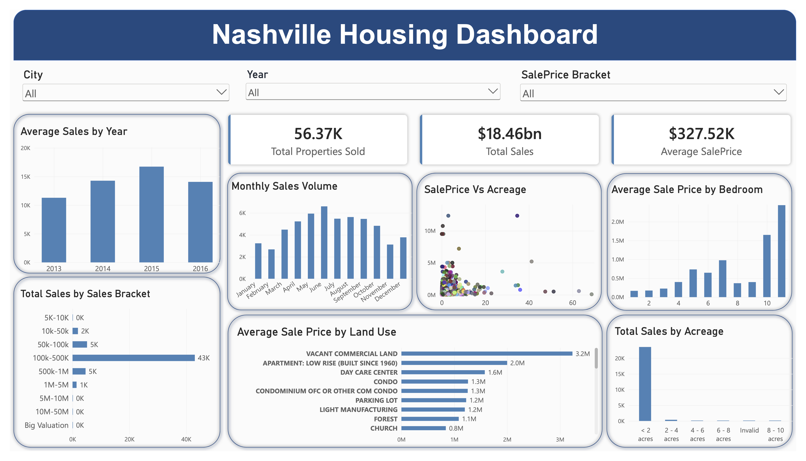

# Nashville Housing Analysis Dashboard

A Power BI dashboard analyzing Nashville housing sales data to explore trends in property sales, pricing, property characteristics, and locations.

## Overview

This project uses the Nashville Housing dataset to create an interactive dashboard covering:

- Property sales trends
- Sales price distribution
- Property characteristics
- Land use and acreage
- City-level sales activity

## Data Preparation

The dataset was cleaned and prepared for analysis before being imported into Power BI.

Additional transformations were performed using Power Query and DAX, including:

- Creating calculated columns and measures
- Creating sales price and acreage brackets
- Preparing fields for visualization and filtering
- Creating KPI measures for the dashboard

## Dashboard
The dashboard includes:

- Total Properties Sold
- Total Sales Value
- Average Sale Price
- Sales Value by Year
- Monthly Sales Volume
- Sales by Price Bracket
- Average Sale Price by Bedrooms
- Average Sale Price by Land Use
- Properties Sold as Vacant
- Sales by Acreage
- Sale Price vs. Acreage
- City-level Sales Analysis

Interactive **Year**, **City**, and **Sale Price Bracket** slicers allow users to explore the data.

## Key Insights

- Over **56K properties** are included in the dataset.
- Total recorded sales are approximately **$18.46 billion**.
- The **$100K–$500K** price range contains the majority of recorded sales.
- Average sale prices vary across property types and cities.
- Most properties are relatively small, with the majority falling below **2 acres**.
- Larger properties generally tend to have higher sale prices, although there is considerable variation between individual properties.

## Tools

**Power BI | Power Query | DAX | SQL**

## Dataset

**Source:** [Kaggle — Nashville Housing Data](https://www.kaggle.com/datasets/tmthyjames/nashville-housing-data)
